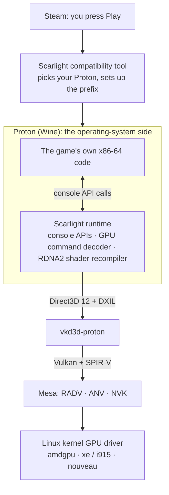

<div align="center">


<br>

[](https://github.com/pablogonz12/Scarlight/actions/workflows/ci.yml)
[](https://github.com/pablogonz12/Scarlight/actions/workflows/linux.yml)
[](LICENSE)
[](https://github.com/pablogonz12/Scarlight/stargazers)

# Scarlight

**Play Xbox Series games on your Linux PC, from Steam.**

Scarlight is a Steam compatibility tool. Proton lets Steam run Windows games on Linux; Scarlight does
the same job for games built for Xbox Series. Install it once, choose it for the game in Steam, press
Play.

<sub>[What it is](#what-it-is) · [What you need](#what-you-need) · [Install](#install) ·
[Status](#status) · [How it works](#how-it-works) · [Roadmap](#roadmap) · [Help wanted](#help-wanted) ·
[Credits](#credits) · [Licence](#licence)</sub>

</div>

> **25 November 2026 — Scarlight is now a Steam compatibility tool.** Until today it was a program you
> started by hand; from today it is one install, one entry in Steam's Compatibility list, and Play.
> The code is the same code; the development setup of the previous line is preserved on branch
> `legacy/amd-hub`. Why, and what moved where: [ANNOUNCEMENT.md](ANNOUNCEMENT.md).

## What it is

Games made for an Xbox Series console do not run on a PC by themselves: they expect the console's
system software, its graphics commands and its shaders. Scarlight supplies the missing console side,
so the game starts and draws on your machine instead. The Windows side it needs — files, memory,
threads, the window — comes from Proton, the same Proton Steam already uses for Windows games; your
graphics driver does the drawing.

You do not run anything from a terminal: Steam launches the game, the way it does with Proton.

Scarlight ships no game files. It runs a copy of a game you legally own, on your own PC.

## What you need

- **Linux with Steam**, native or Flatpak.
- **A graphics card with a Mesa Vulkan driver**: AMD (RADV), Intel (ANV), or NVIDIA's open NVK.
  Vulkan 1.3 or newer. A proprietary driver is not a target of this project.
- **A Proton you already have**: GE-Proton or Valve's Proton. Scarlight uses its Wine; we neither
  ship nor fork Proton.
- **The game's files**, from a copy you own.

## Install

Three steps. Full detail — every option, logs, uninstall, troubleshooting — in
**[docs/steam.md](docs/steam.md)**.

1. **Put Scarlight in Steam's compatibility tools folder.** Download `Scarlight-<version>.tar.gz`
   from [Releases](https://github.com/pablogonz12/Scarlight/releases), then run this in the folder you
   downloaded it to (or give `tar` the archive's full path, e.g.
   `~/Downloads/Scarlight-0.1.0.tar.gz`):

   ```bash
   cd ~/Downloads
   mkdir -p ~/.local/share/Steam/compatibilitytools.d/
   tar -xzf Scarlight-<version>.tar.gz -C ~/.local/share/Steam/compatibilitytools.d/
   ```

   Flatpak Steam uses `~/.var/app/com.valvesoftware.Steam/data/Steam/compatibilitytools.d/`.
   From a source checkout instead, `tools/steam-compat/install.sh` does the same.
2. **Restart Steam.**
3. **Choose it for the game.** If the game is not in your library yet, add it first: *Steam → Games →
   Add a Non-Steam Game to My Library → Browse…* and pick its `.exe`. Then *Library → right-click the
   game → Properties → Compatibility →* tick
   **Force the use of a specific Steam Play compatibility tool** and pick **Scarlight (Xbox Series)**.
   Press Play.

Two things a release leaves to you, both one step: if Steam cannot find the Proton Scarlight should run
on, name yours in `compatibilitytools.d/Scarlight/scarlight.conf` (`PROTON=`); and put your own copy of
DXC's `dxil.dll` and `dxcompiler.dll` in `Scarlight/files/` (Microsoft's binaries are not redistributed
by a Linux release). [docs/steam.md](docs/steam.md) has both.

## Status

**Not playable yet.** This is early work, and it is better to say so plainly: the game starts, its
menus work, and its world appears — but the picture is incomplete and dark in places, and it runs at
a few frames per second. One game has been tried, on one graphics card.

| What | Today |
|---|---|
| Starting the game, menus, sound, controller | Works; menus at 30 fps |
| The game's world | Shows, but only partly: lit and textured in places, much of the scene dark |
| Speed | **0.1–3 fps**: 1.5–3 in the fixed scene we measure, down to 0.1 in busy scenes while the game's copies and textures queue up |
| Shaders | **751 / 751** of the game's world shaders translate; 749 / 751 build a real pipeline on the driver |
| Time to the world | 133–218 s |
| Stability | Some builds hang at start or when the world loads |
| **Playable** | **No** |

Measured 25 Nov 2026 on one machine: **AMD RX 9070 XT**, Mesa 26.3.1 (RADV), CachyOS, GE-Proton11-14.
No other card and no other game have been tried, so nothing here promises anything about yours.

<!-- progress:start -->
Progress in detail — what is measured, how, and where each number comes from: [docs/PROGRESS.md](docs/PROGRESS.md).
<!-- progress:end -->

## How Scarlight differs from other Xbox Series projects

Several projects take on Xbox Series games on a PC. They aim at different platforms, so the rows below
are about fit, not quality.

| | Scarlight | Other Xbox Series projects (Windows-first layers) |
|---|---|---|
| Target platform | Linux, through Steam | Windows 10/11 x64; no Linux target documented |
| How a game is started | Picked in Steam's Compatibility list, then Play; Steam launches it | The project's own program on Windows; on Linux you would set up a Wine prefix by hand |
| What you install | A release tarball into `compatibilitytools.d`, or one `install.sh`, plus a Proton you already have | Build from source with the project's toolchain on Windows, then supply the D3D12 and DXC files yourself |
| Graphics driver focus | Built and tuned for Mesa's open Vulkan drivers (RADV, ANV, NVK) | Any Direct3D 12 driver with shader model 6.6 (mesh shaders for the world) |
| Shader route | The console's RDNA2 shaders are recompiled to DXIL today, then drawn through vkd3d-proton and Vulkan; direct SPIR-V is in progress | The console's RDNA2 shaders are recompiled to DXIL and drawn through Direct3D 12 |
| Linux test coverage | One game on one card: RX 9070 XT, Mesa 26.3.1 RADV | None documented; their READMEs require Windows |

<sub>Facts as the public READMEs of those projects stated them on 25 Nov 2026; check them yourself for
anything that has changed since.</sub>

## How it works



[](https://docs.mesa3d.org/)
[](docs/hardware.md)
[](https://www.vulkan.org/)

- **Steam starts it.** The game's `.exe` is a Non-Steam Game whose compatibility tool is Scarlight.
  The tool finds your Proton, prepares the game's prefix and shader cache, and asks Steam for the same
  runtime container Proton gets.
- **Proton does the operating-system side.** The game's file, thread, memory and window calls are
  Wine's job, through the Proton you installed.
- **Scarlight does the console side.** It runs inside that Wine process next to the game: it answers
  the console system APIs the game calls, decodes its GPU command streams, and recompiles its RDNA2
  shaders and pipelines for your card.
- **vkd3d-proton and Mesa draw it.** Scarlight hands Direct3D 12 and DXIL to vkd3d-proton, which turns
  them into Vulkan and SPIR-V for Mesa's RADV (AMD), ANV (Intel) or NVK (NVIDIA). Mesa is open source,
  so the driver is ours to read, tune and fix — that is why the project is built around it. RADV on
  RDNA4 is the only one tested so far.

Design notes: [docs/architecture.md](docs/architecture.md).

## Roadmap

| Stage | Goal | Where it stands |
|---|---|---|
| **Now** | One core, every shader | The best translator and GPU code of the related projects merged into one core: 751 of 751 world shaders and 2,907 of 2,912 recorded shaders translate offline |
| **Now** | Speed: stop copying the game's memory every frame | Most of a slow frame is copies of the game's memory. In progress: copies on the graphics card, the game's private memory shared with the card instead of copied, and copies that avoid a slow path in Wine |
| **Now** | Loading and pop-in | Files are read at a small fraction of what the disk can do; the reader is being measured stage by stage |
| **Next** | Dark areas lit | The game traces rays in its own compute shaders, and that part is switched off today; turning it on (or using the card's ray tracing on RADV) is the way to light shadowed areas |
| **Next** | Faces and missing geometry | Specific shaders and copies that are dropped; each has a named cause |
| **Later** | Talk to Vulkan directly | Shaders straight from the console's instructions to SPIR-V, with no DXIL in between: an experimental translator already covers about half of the compute shaders |

No dates; these are goals, not results. Every number above is from offline checks on one machine.

## Help wanted

The missing pieces are specific, and **people who know Wine, Proton or Mesa are the most useful of
all** — this project spends its time where those three meet:

- **Wine / Proton:** the OS-side behaviour a console game expects (threads, timing, file layout), and
  how a compatibility tool should hand work to a Proton build.
- **Mesa (RADV, ANV):** why a pipeline that builds fine still stalls on first use, shader cache
  behaviour, and what our command stream costs on the driver side.
- **vkd3d-proton:** the Direct3D 12 features a console-shaped workload leans on.
- **Rust, and the formats:** command-stream decoding, the shader translator, the RDNA2 instruction set.
- **Anyone with another Mesa card** (RDNA1-3, Vega, Arc, Xe, NVK): a run on your machine is as useful
  as a patch.

Send a [test report](https://github.com/pablogonz12/Scarlight/issues/new?template=test-report.yml) or
[bug report](https://github.com/pablogonz12/Scarlight/issues/new?template=bug-report.yml) with your
card, driver and Mesa version, kernel, distribution, Proton build, and the last ~50 lines of
`scarlight.log`. Text and logs only: no game files, no screenshots. Pull requests are welcome;
[CONTRIBUTING.md](CONTRIBUTING.md) has the build, test and asset rules, and
[Discussions](https://github.com/pablogonz12/Scarlight/discussions) is where questions go.

## Credits

Scarlight is a port of the project named in [CREDITS.md](CREDITS.md) (GPL-3.0), whose history and
authorship this tree keeps; every contributor is named there, along with the third-party licences a
release ships.

## Licence

GPL-3.0-or-later; see [LICENSE](LICENSE).

Not affiliated with or endorsed by Microsoft. Xbox and Xbox Series are trademarks of Microsoft.

<sub>Development lab of the previous line (offline shader checks, GPU run queue, performance ledger,
worker pipeline) lives on branch
[`legacy/amd-hub`](https://github.com/pablogonz12/Scarlight/tree/legacy/amd-hub), with tag
`legacy-amd-hub-2026-11-25`. Nothing is deleted; `main` continues from the same commit.</sub>
