<div align="center">


<br>

[](https://github.com/pablogonz12/Scarlight/actions/workflows/ci.yml)
[](LICENSE)


[](#-contributing)
[](https://github.com/pablogonz12/Scarlight/stargazers)

**Not playable yet.** Details below.

<sub>[What it is](#-what-it-is) · [How it fits](#-how-it-fits-together) · [Status](#-status) · [Quick start](#-quick-start) · [Windows](#-quick-start-windows) · [Linux](#-quick-start-linux-wine--ge-proton) · [Controls](#-controls) · [Contributing](#-contributing) · [Thanks](#-thanks)</sub>

</div>

<p align="center"></p>

## ✨ What it is

Scarlight runs an Xbox Series X|S title's own x86-64 code on a PC, using the files you supply. It
loads the title's executable, answers its console-only calls, and turns its GPU commands and
shaders into Direct3D 12 for your graphics card. The focus is **AMD RDNA4 on Linux under
Wine/Proton**; Windows works too. Scarlight is based on
[VIctory](https://github.com/Marvisak/VIctory) by Marvis and its contributors (GPL-3.0, history
kept). It adds tested fixes from VIctory's open
pull requests and forks, each merged with its author's credit ([INTEGRATION.md](INTEGRATION.md)),
plus its own. No game files, dumps or screenshots are in this repository.

## 🧭 How it fits together

```mermaid
flowchart LR
    A["<b>Title's x86-64 code</b><br/>your own copy,<br/>outside the repo"] --> B["<b>Loader</b><br/>victory-loader<br/>map and bind imports"]
    B --> C["<b>HLE</b><br/>victory-hle<br/>console APIs on the host"]
    C -->|"D3D12.X calls"| D["<b>GPU translation</b><br/>victory-gpu<br/>commands and memory"]
    D -->|"shaders, at pipeline creation"| E["<b>Shader recompiler</b><br/>victory-shader<br/>console GPU machine code to DXIL"]
    D --> F["<b>Direct3D 12</b>"]
    E --> F
    F --> G["<b>vkd3d-proton</b><br/>Direct3D 12 on Vulkan<br/>(Linux, Wine/Proton)"]
    classDef hot fill:#1a0838,stroke:#ff2e63,color:#ffd9e6,stroke-width:2px
    classDef cool fill:#0a2a3a,stroke:#19d8ff,color:#dcfaff,stroke-width:2px
    classDef warm fill:#2a1408,stroke:#ffb347,color:#ffe9c9,stroke-width:2px
    class A,B,C hot
    class D,E warm
    class F,G cool
```



Shaders are translated when the title creates a pipeline, from the bytes it passes. On Windows the
host's own Direct3D 12 driver takes the place of vkd3d-proton. Crates and import resolution:
[docs/architecture.md](docs/architecture.md).

<p align="center"></p>

## 🚦 Status

**Not playable yet.** In short:

> [!NOTE]
> **24 Nov 2026: first lit picture on AMD + Linux.** With the [fxceless](https://github.com/fxceless) fork
> as the base (Scarlight's move onto it is in progress) and Microsoft's `d3dcompiler_47.dll` next to the exe as a
> stop-gap (Wine's built-in compiler rejects its runtime helper shaders), the opening scenes render lit on an
> RX 9070 XT under GE-Proton: 4,900-7,000 draws per frame, about 1-4 fps, menus, pad and sound working. Many
> surfaces are still untextured and shadowed areas are dark. `main` itself does not render the world yet; this
> branch does, and the table below describes this branch.

<p align="center"></p>

| Works | Does not |
|---|---|
| Boots to the menus | World frame rate: about 1-4 fps |
| Menus at 30 fps | Shadowed areas: no ray-traced light yet, they stay black |
| The world renders lit and textured | Any real gameplay |

On this branch the world picture works; that is what the note above is about. On Linux under Wine it
needs Microsoft's `d3dcompiler_47.dll` next to the exe until our own shader-based fallback lands: Wine's
built-in compiler refuses the helper shaders with `E5005`, and every indirect draw and dispatch is
dropped, which leaves the world black. On Windows the built-in compiler works. The frame rate is
limited by copying the title's memory. Tested setup and measurements: [AMD-LINUX.md](AMD-LINUX.md).

<!-- state:begin -->
## Project state

<div align="center">

### At a glance

| World shaders | Full archive | Best world fps | Furthest |
|:---:|:---:|:---:|:---:|
| **766 / 768** offline on RADV | **25,526 / 25,694** translated | **1-4** on this branch | World renders lit and textured; shadowed areas dark |

</div>

Last updated: 24 Nov 2026, `pr/scarlight-next` (the fxceless base).

### Milestones

| | Milestone | Note |
|---|---|---|
| ✅ | Boots | Boots into the title's own menus |
| ✅ | Menus | 30 fps, drawn and interactive |
| ✅ | Loads world | World streams in and the title's audio plays |
| 🟡 | World picture | Lit and textured on RX 9070 XT / Linux with a native `d3dcompiler_47`, about 1-4 fps; shadowed areas stay black (no ray-traced light); 2 of 768 world programs still skip their draws |
| ❌ | Playable | 1-4 fps: no real gameplay yet |

### Shader translation

| Programs | Translated | Total | Progress |
|---|---|---|---|
| **All programs** | **25,526** | **25,694** | `██████████ 99%` |
| World set, translate → SPIR-V → RADV pipeline | 766 | 768 | `██████████ 100%` |

*Full archive: `victory translate` under Wine on the title's shader archive (log `translate-fx.txt`), with this base's own default host wave widths, so not byte-identical to the earlier VIctory `main` table. World set: 768 programs, each through translation, SPIR-V validation and a real RADV pipeline; the two that fail are a wave sum of 16-bit floats, and one program whose DXIL times out into a core dump.*

<details>
<summary>Breakdown: per stage and top failure reasons</summary>

| Programs | Translated | Total | Progress |
|---|---|---|---|
| Vertex + pixel | 14,140 | 14,247 | `██████████ 99%` |
| Compute | 2,624 | 2,682 | `██████████ 98%` |
| Mesh | 8,762 | 8,765 | `██████████ 100%` |
| **All programs** | **25,526** | **25,694** | `██████████ 99%` |

**Top remaining shader failures (same measurement)**

| Refusals | Reason |
|---|---|
| 195 | an address in an SGPR that is no root parameter |
| 40 | a descriptor chosen by control flow |
| 40 | a descriptor read only as data |
| 33 | a lane mask holding lanes elsewhere, read as data |
| 13 | an opaque lane mask |
| 11 | a lane mask read as data |
| 10 | a hardware SGPR input |
| 8 | the first half of an interpolation |

</details>

### Performance

| Measurement | RX 9070 XT, Linux / Wine (24 Nov 2026) |
|---|---|
| Menus | 30 fps |
| World | 1-4 fps (2.02 over 20 minutes with the native compiler; 4.72 in the longest run) |
| Title-memory copies | 114-158 ms/frame |

### Tested hardware

| GPU | OS / driver | Furthest stage |
|---|---|---|
| RX 9070 XT (RDNA4) | CachyOS, Mesa 26.3.1 RADV; GE-Proton11-14 with vkd3d-proton master, native `d3dcompiler_47` | World renders lit and textured at 1-4 fps (shadowed areas black); 766 of 768 world programs build a RADV pipeline |

<!-- state:end -->

<p align="center"></p>

## ⚡ Quick start

The short version; the platform sections below have the full steps (build, runtime, environment).

```bash
git clone https://github.com/pablogonz12/Scarlight && cd Scarlight
cargo xtask install-hooks                # asset-policy check on every commit
cp victory.example.toml victory.toml     # PowerShell: copy; then set your paths (outside the repo)
cargo test --workspace                   # no game data needed
cargo run -p victory -- config           # check the build and your paths
```

Then build and run: [Windows](#-quick-start-windows) or [Linux (Wine / GE-Proton)](#-quick-start-linux-wine--ge-proton).

## 📋 What you need

- **Your own copy of the title.** None is included, and none will be linked or shared.
- A GPU with Direct3D 12 and shader model 6.6 (mesh shaders for the world), on Windows 10/11 x64
  or Linux with Wine/Proton.
- Rust (the version is pinned in `rust-toolchain.toml`) if you build from source.

## 🪟 Quick start: Windows

1. Install [Rust](https://rustup.rs) and the Visual Studio 2022 Build Tools with "Desktop
   development with C++".
2. Get the code and make your config (paths must be outside the repo):
   ```powershell
   git clone https://github.com/pablogonz12/Scarlight
   cd Scarlight
   cargo xtask install-hooks                # asset-policy check on every commit
   copy victory.example.toml victory.toml   # then set your paths
   ```
3. Check the build and your paths (no game data needed for the tests):
   ```powershell
   cargo test --workspace
   cargo run -p victory -- config
   ```
4. Build and run:
   ```powershell
   cargo build --release -p victory
   target\release\victory.exe run <game dir>\<the title's exe> --execute
   ```

The title needs several GiB of free Windows commit at startup (Task Manager → Performance →
Memory → Committed). If `crashes.log` reports Windows error 1455, close other apps or raise the
paging file size.

## 🐧 Quick start: Linux (Wine / GE-Proton)

1. Install Rust, then build a Windows binary from Linux:
   ```bash
   rustup target add x86_64-pc-windows-msvc
   cargo install cargo-xwin                   # once
   cargo xwin build --release -p victory --target x86_64-pc-windows-msvc
   ```
   Add `--features diagnostics` for per-frame copy and watch statistics.
2. Install a GE-Proton build (tested: GE-Proton11-14) and run its `wine` binary directly, not the
   Proton script.
3. Put **vkd3d-proton master**'s `d3d12.dll` and `d3d12core.dll` next to `victory.exe` (the build
   output folder). Stock vkd3d-proton 3.1 crashes at world entry.
4. Set the environment and run:
   ```bash
   export WINEDLLOVERRIDES="d3d12,d3d12core,dxgi,d3d11,d3d10core=n,b"
   export VKD3D_CONFIG=ignore_shared_fence
   export VICTORY_NO_WATCHDOG=1
   export VICTORY_GAME_DIR="$HOME/victory-data/game"
   /path/to/GE-Proton11-14/files/bin/wine \
     target/x86_64-pc-windows-msvc/release/victory.exe \
     run "$VICTORY_GAME_DIR/<the title's exe>" --execute
   ```

Free memory matters: anything that pins GPU memory (a local LLM server, say) pushes the world into
swap. More platform notes: [AMD-LINUX.md](AMD-LINUX.md).

## 🎮 Controls

A gamepad works if one is connected. Otherwise the keyboard acts as a pad while the title's window
has focus:

| Keys | Pad |
|---|---|
| Enter, Backspace, X, Y | A, B, X, Y |
| Esc, Tab | Menu, View |
| Arrows | D-pad |
| W A S D | left stick |
| I J K L | right stick |
| Q / E | shoulders |
| Z / C | triggers |
| F / H | stick clicks |

<details>
<summary><h2 style="display:inline">🛠️ Troubleshooting and logs</h2></summary>

| Problem | Fix |
|---|---|
| Crash at world entry | Your `d3d12.dll`/`d3d12core.dll` are stock vkd3d-proton 3.1; use master's or GE-Proton11-14's instead |
| Out of memory, or the world crawls | Close apps that pin GPU memory; on Windows also check committed memory (error 1455) |
| World is black | Known, not fixed yet: shaders that do not translate have their draws skipped |
| The title waits for the GPU, then quits or restarts | `VICTORY_NO_WATCHDOG=1`; on 32-lane hosts (NVIDIA) also try `VICTORY_SKIP_WAVE64=mesh,compute` |
| `victory` says no paths, or exits at once | Run `victory config`: a path is unset, wrong, or inside the repo; set `VICTORY_GAME_DIR` |

Logs: `VICTORY_LOG=victory_loader=trace,info`. Crashes and host GPU failures are appended to
`crashes.log` in the data folder (default `%LOCALAPPDATA%\victory\data`). Diagnostics variables
and commands: [AMD-LINUX.md](AMD-LINUX.md#diagnostics).

</details>

<p align="center"></p>

## 🤝 Contributing

Pull requests go to `main` only. CI runs clippy and the workspace tests on Windows, and CodeRabbit
reviews each PR. If you are merging someone's upstream fix, keep their commits and their credit:
[INTEGRATION.md](INTEGRATION.md) lists every merged pull request with its author, so it can be
sent upstream. Code that also helps Windows or other GPUs should go to
[Marvisak/VIctory](https://github.com/Marvisak/VIctory) too. Internal crate, binary and
environment-variable names stay `victory*` so upstream fixes keep merging. Never commit game files;
the asset-policy hook checks it (`docs/asset-policy.md`).

## 📜 License

GPL-3.0-or-later; see [LICENSE](LICENSE). Architecture overview: [docs/architecture.md](docs/architecture.md).

<p align="center"></p>

## 💖 Thanks

Scarlight is derived from [VIctory](https://github.com/Marvisak/VIctory) by Marvis and its contributors, and
from [@fxceless](https://github.com/fxceless)'s fork (`578d459`, `7b0f736d`), which is the base of the branch
that first renders the world lit; all keep their commit history. Thanks to @fxceless and @ZazaJr24 for that
base, to @deadkid14 and @ItsYusei99 for finding what Wine's `d3dcompiler_47` refuses, to the authors listed in
[INTEGRATION.md](INTEGRATION.md), [JMAN730/victory](https://github.com/JMAN730/victory), and everyone whose
fixes made the world load.

<p align="center">
<a href="https://github.com/pablogonz12/Scarlight/graphs/contributors"></a>
</p>
