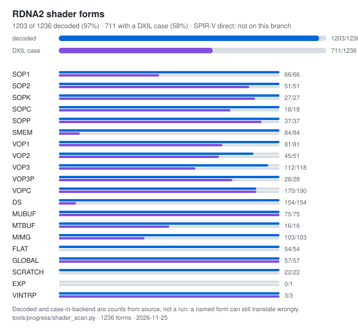

# Progress

**100 % in every row means every part the title uses is implemented and verified on Mesa; it is the target, not a guarantee, and correctness is checked by runs, not counts.**

Measured on 25 Nov 2026, build 5fca579b, RX 9070 XT (RDNA4) / Mesa 26.3.1 RADV. Diagnostics builds. No other GPU has been tried, and every number below comes from that one card.

- Every percentage is a share of a **named set that was counted** on this machine: an import table, a shader archive, a frame of recorded work. None of them is a share of the title as a whole, and the sets overlap (a program in the shader archive is not a distinct piece of the port).
- **Implemented** is what our code does today; **verified** is how much of that a run has shown working. They are separate columns because a decoder can claim an opcode that no run has proved. An em dash means that column was not counted for that row.
- The counts are taken from files the user supplies; nothing from them is stored in this repository, and no title, program or asset name appears here.
- A set can be complete without being ours: every import of the title **resolves** (0 missing), but 427 of the 587 are Wine (Proton) and 72 belong to the title's own libraries. The System APIs area shows both numbers side by side, and only the 88 HLE ones are code this project wrote.

Regenerate with `tools/progress/collect.sh` (local, needs your own copy of the title) and `tools/progress/render.py`; both are idempotent and the JSON holds counts only.

## System APIs (HLE)

What the title's import table asks for and who answers it. Every import of the image resolves, but most of them are not our code: our HLE modules answer a small share, Wine answers the bulk, and the rest are libraries the title ships itself. That split is the honest reading of the bars below.

| Set | Implemented | Verified | Progress | What is counted |
|---|---|---|---|---|
| Imports resolved | 587 / 587 | 587 / 587 | ████████████ 100 % | 0 of 587 imports did not bind in this loader run; the census scans the image, the run binds every DLL |
| … of which by ScarLight's HLE modules | 88 / 587 | 88 / 587 | ██░░░░░░░░░░ 15 % | the console DLLs and the kernel calls this project implements itself |
| … of which by Wine (Proton) | 427 / 587 | 427 / 587 | █████████░░░ 73 % | passed through to the host's own implementations; working, but not our code |
| … of which by the title's own libraries | 72 / 72 | 72 / 72 | ████████████ 100 % | shipped with the title and loaded as they are: satisfied, nothing for us to write |
| Kernel and API sets (43 DLLs) | 280 / 280 | 280 / 280 | ████████████ 100 % | kernel and API-set calls; the split between ours and Wine's is in the row above |
| Console DLLs: memory, audio, input, GPU | 38 / 38 | 38 / 38 | ████████████ 100 % | console memory, audio, input and GPU entry points, all in our HLE |
| C runtime and OS (msvcp140, vcruntime, ws2_32, winhttp, bcrypt, mfplat) | 187 / 187 | 187 / 187 | ████████████ 100 % | C runtime and OS calls, most of them passed to Wine |
| HLE exports in the registry beyond this image's needs | more | used | spare | extra console API surface beyond this image's needs, so another build of the title can bind without a new module |

- Resolved counts come from the import census of the title image and from the loader's bound line in a world run (`hle=88 host=427 title=72 missing=0`).
- The 427 Wine-resolved imports are host pass-throughs: they work, and this project does not implement them. No row here claims them as ours.
- Networking modules exist in our HLE but are switched off; console-only networking is not a target of this port.

## Shaders

Two sets are counted: the world set used for offline checks, and the title's whole shader archive. The world set is the one every change is checked against, end to end; the archive is the size of the real job, and only its translation and emission are counted so far.

| Set | Implemented | Verified | Progress | What is counted |
|---|---|---|---|---|
| World set, translated to host shader | 751 / 751 | 751 / 751 | ████████████ 100 % | translated to host shader with nothing refused and nothing undecodable |
| World set, translated + validated + real RADV pipeline | 749 / 751 | 749 / 751 | ███████████░ 99 % | 749 of 751 reached a real pipeline in this run; the other 2 stop before one |
| Whole archive, translated | 26,084 / 26,084 | — | ████████████ 100 % | every program reaches IR; the traced-resource count is in the translator's summary |
| Whole archive, host shader emitted: all stages | 25,602 / 25,694 | — | ███████████░ 99 % | vertex + pixel, compute and mesh: 92 of 25,694 programs of those stages are not emitted |
| Whole archive, host shader emitted: vertex + pixel | 14,164 / 14,247 | — | ███████████░ 99 % | 83 programs of this stage are not emitted; no pipeline validation has been run on the archive yet |
| Whole archive, host shader emitted: compute | 2,676 / 2,682 | — | ███████████░ 99 % | 6 programs of this stage are not emitted; no pipeline validation has been run on the archive yet |
| Whole archive, host shader emitted: mesh | 8,762 / 8,765 | — | ███████████░ 99 % | 3 programs of this stage are not emitted; no pipeline validation has been run on the archive yet |
| ISA: opcode-table entries the decoder names | 313 / 1,232 | — | ███░░░░░░░░░ 25 % | 313 of the 1,232 opcode-table entries are named in the decoder; the title uses far fewer than the table holds, and a per-program opcode census is not taken yet |

- Emitted per stage is 25,602 of 25,694 programs the archive classifies as vertex/pixel, compute or mesh; the further 390 are programs the console structure puts in none of those stages.
- The stop reasons are our own diagnostic classes, counted in the translator's summary; the largest single class is "a scalar memory read as data".
- The verified column covers the 751-program world set only. The archive has no validated pipeline column yet: translate alone is not a run.

## GPU command stream

What the title records per frame and what reaches the card. The headline row measures one real world frame: the draws and dispatches it recorded, minus the ones dropped. The reasons listed below come from a separate reference run and are **not** an accounting of that frame — they are the reasons drops have been seen, with the count each reached in the run that showed it. Ray tracing is off on purpose, so most drops are one intended reason and not a gap in the port.

| Set | Implemented | Verified | Progress | What is counted |
|---|---|---|---|---|
| Recorded work that reaches the card | 4,309 / 4,688 | 4,309 / 4,688 | ███████████░ 92 % | the last world frame of the newest run that has one: the backend's own per-frame lines |
| D3D12 calls the title makes that our backend has | 99 / 128 | 99 / 128 | █████████░░░ 77 % | present in the backend's sources; the rest are enum and helper surfaces, not missing entry points |
| Drops: ray-tracing hit shading, left out | — | — | off | left out on purpose until the trace path is correct, and the largest single reason for drops |
| Drops: one stage of the ray-tracing structure builder | — | — | off | off with the same switch as the trace path |
| Drops: one whole-wave compute step | — | — | dropped | a section step our wave simulation does not follow yet |
| Drops: compute and pixel programs while their pipeline is made | — | — | late | each named program appears once and then runs; that is the pipeline area's business |

- The reference run records 168 world frames at 2.04 fps; drop reasons are the backend's own log lines, summed per frame in that run.
- Nothing is dropped as "no host pipeline": every drop is a named, deliberate or known gap.

## Pipelines

A draw cannot run until its pipeline exists on the host. The world set can be built entirely offline, and the pre-bake list covers most of what the title asks for in a session; what is left is created while the title waits for it.

| Set | Implemented | Verified | Progress | What is counted |
|---|---|---|---|---|
| World set: pipelines that build offline | 749 / 751 | 749 / 751 | ███████████░ 99 % | 2 of 751 do not reach a pipeline in this run |
| Pipelines the title asks for, covered by the pre-bake list | 1,785 / 2,601 | — | ████████░░░░ 69 % | 1,785 of the 2,601 keys the title's own early list names can be built from the saved library |
| Late creates per frame in a world run | late | measured | late | programs dropped while their pipeline is made, summed over a whole run |

- The pre-bake list is the union of the early-pipeline key list and the warm pipeline library the title saved itself; the gap is what a session creates on demand.
- One program takes 3.6 s to compile alone, so the pre-bake must not schedule it last.

## Features

Status words, not percentages: a feature is either shown working on this machine, partly working, or off. These are the rows that decide whether the port is playable, and none of them is finished.

| Feature | Implemented | Verified | Progress | What is counted |
|---|---|---|---|---|
| Lit, textured world | — | — | partly | the fixed test scene renders lit and textured, at the speed the Performance area reports |
| Shadows | — | — | partly | shadowed areas read too dark; cascade selection is not verified |
| Characters and faces | — | — | broken | some characters' faces fail to render; regressed again in the last change window |
| Ray tracing | — | — | off | the structure builder and trace path sit behind a switch; the fallback shading is what draws |
| Audio | — | — | works | menu and world audio through the console audio DLLs |
| Input | — | — | works | gamepad through the console input DLL |
| Saves | — | — | not yet verified | the save module exists; no run has written and reloaded a save |
| Streaming (DirectStorage) | — | — | partly | reads work through the host file path; the submitted-queue path is not used |
| Video playback | — | — | partly | the title's own codec library loads; no cutscene has been played end to end |
| Networking | — | — | off | not a target of this port |

- "Partly" means the feature appears in at least one frame and is wrong or incomplete in a way the picture notes name; "broken" means it regressed and is being fixed.

## Mesa reach (compiled offline, not run)

Whether the world shader set compiles for a GPU family's Mesa driver, without that GPU. Mesa's noop drm-shim fakes each chip, so RADV and ANV build every pipeline with that family's ISA and limits. Every AMD generation up to ours compiles the whole set except Vega, whose mesh-shader programs abort the driver. On Intel, Arc B builds the whole set, while Arc A and Xe-LPG each miss one program on the stub's own gap. This is a compile result: only RDNA4 has actually been run.

| GPU families | Implemented | Verified | Progress | What is counted |
|---|---|---|---|---|
| AMD families whose whole world set compiles offline | 4 / 5 | — | ██████████░░ 80 % | 4 of 5 AMD families compile the whole set through the noop shim (Mesa driver, no GPU) |
| Arc B (Xe2): world programs that build pipelines offline | 751 / 751 | — | ████████████ 100 % | 751 of 751 build a pipeline through ANV and Mesa's Intel noop shim; none is refused; median 35 ms per program |
| Arc A (DG2): world programs that build pipelines offline | 750 / 751 | — | ███████████░ 99 % | 750 of 751 build a pipeline; the one miss is the stub's gap (Unknown drm_i915_query_item), not a compiler error; median 78 ms per program |
| Xe-LPG: world programs that build pipelines offline | 750 / 751 | — | ███████████░ 99 % | 750 of 751 build a pipeline; the one miss is the same stub gap; median 69 ms per program |
| Vega (gfx900): world programs that compile offline | 669 / 751 | — | ███████████░ 89 % | 82 of 751 abort the driver: every mesh-shader program, and GFX9 has no mesh shader support in RADV |
| Families with a run, not just a compile | 1 / 8 | — | ██░░░░░░░░░░ 12 % | only our card: every other family has compiled pipelines and no run |

- Sources: `family-matrix-20261125-134909-2134785.tsv` (AMD, five families + the real card as control), `family-matrix-20261125-140636-2410746.tsv` (Intel: dg2, bmg, mtl) and `family-matrix-20261125-141256-2481125.tsv` (re-check of gfx1201 and acm: 751/751 and 750/751, the same result); the shim column for our own family matches the real-GPU column exactly, so the harness does not change the answer.
- Compiled offline is not run. On RDNA1 all 82 mesh programs create, yet RADV does not advertise `VK_EXT_mesh_shader` there, so a program that uses mesh, barycentric or ray query at draw time needs the game's own fallback path.
- Intel: ANV needs `libvulkan_intel.so` plus Mesa's Intel noop shim from the same build; both were built for this run. The one program that fails on dg2 and mtl is the same class, and it stops on the stub's `drm_i915_query_item` gap, not on a shader the compiler refused. Nothing Intel has been run on a card.

## Performance

Speed is measured at one fixed scene, the only figure compared between builds, against the console's 30 fps target. The port is far from it, and the card is idle for most of the frame because the CPU side is the cost.

| Measure | Implemented | Verified | Progress | What is counted |
|---|---|---|---|---|
| Fixed test scene vs the 30 fps console target | 1.6 / 30 | 1.6 / 30 | █░░░░░░░░░░░ 5 % | 1.6 fps median at the window scene of the last recorded run, compared only with rows of the same scene |
| Card busy share of the frame | 30 / 100 | 30 / 100 | ████░░░░░░░░ 30 % | by our own clock count; the rest is the title's CPU work and our copies |
| Time to the world | seconds | measured | no target set | from launch to the first world frame; the pre-bake should cut it |

- fps is the median of samples at the `window` scene, compared only between rows with the same scene label; `world_fps` from other runs mixes cutscenes and is never published.
- The frame is split as: title CPU work, our copies, then the card. Our copies are 98-111 ms of a 515-540 ms frame in the measured world run.

## How each number is measured

- **System APIs (HLE)**: the title image's import table is scanned by our own census tool, which marks each function as answered by one of our HLE modules, passed through to Wine, exported by the title's own images, or missing; a world run prints the same split on its `bound` line, which is the verified column. Only the HLE column is code we wrote
- **Shaders**: `victory translate` over the whole shader archive for the translated and emitted counts, and over the 751-program world set with dxil-spirv, `spirv-val` and a real RADV pipeline for the verified column
- **GPU command stream**: the backend's per-frame log lines in a world run, summed by drop reason; the D3D12 calls are the title's call list against the presence of each name in the backend's sources
- **Pipelines**: the offline world-set run (cold and warm Mesa cache), the title's own saved pipeline keys, and the `without a host pipeline` lines of a world run
- **Features**: run verdicts and the picture notes; a feature is never called working without a frame that shows it
- **Mesa reach**: the five-family offline matrix through Mesa's amdgpu noop shim, plus the real card as control; a family counts only when all of its pipelines compile
- **Performance**: the fixed-scene runner's median fps and the launch-to-world time from the loader's own timestamps

<!-- isa:start -->
## ISA coverage, counted from source

**This section needs no title, so CI regenerates it on every push; the per-title rows above need your own copy of the title and stay as they are.** It compares the decoder's opcode tables with a public reference list of every RDNA2 instruction form, then asks each backend whether it has a case for the form. Decoded, and a case in a backend, are statements about our code, not about a shader that ran: a form we name can still be translated wrongly, and nothing here is a picture.

**1200 of 1236 reference forms decoded; 680 with a DXIL-path case; the direct SPIR-V emitter is not on this branch, so that column is empty.**

| Encoding | Forms | Decoded | DXIL path | … via a family prefix | SPIR-V direct | Bar |
|---|---|---|---|---|---|---|
| SOP1 | 66 | 66 | 23 | 2 | not on this branch | ████████████ 100 % |
| SOP2 | 51 | 51 | 44 | 0 | not on this branch | ████████████ 100 % |
| SOPK | 27 | 27 | 12 | 12 | not on this branch | ████████████ 100 % |
| SOPC | 18 | 18 | 4 | 10 | not on this branch | ████████████ 100 % |
| SOPP | 37 | 37 | 30 | 0 | not on this branch | ████████████ 100 % |
| SMEM | 84 | 84 | 9 | 0 | not on this branch | ████████████ 100 % |
| VOP1 | 81 | 81 | 59 | 0 | not on this branch | ████████████ 100 % |
| VOP2 | 51 | 44 | 36 | 1 | not on this branch | ██████████░░ 86 % |
| VOP3 | 118 | 110 | 63 | 2 | not on this branch | ███████████░ 93 % |
| VOP3P | 28 | 28 | 3 | 19 | not on this branch | ████████████ 100 % |
| VOPC | 190 | 170 | 0 | 170 | not on this branch | ███████████░ 89 % |
| DS | 154 | 154 | 11 | 0 | not on this branch | ████████████ 100 % |
| MUBUF | 75 | 75 | 0 | 75 | not on this branch | ████████████ 100 % |
| MTBUF | 16 | 16 | 1 | 7 | not on this branch | ████████████ 100 % |
| MIMG | 103 | 103 | 11 | 16 | not on this branch | ████████████ 100 % |
| FLAT | 54 | 54 | 0 | 0 | not on this branch | ████████████ 100 % |
| GLOBAL | 57 | 57 | 0 | 57 | not on this branch | ████████████ 100 % |
| SCRATCH | 22 | 22 | 0 | 0 | not on this branch | ████████████ 100 % |
| EXP | 1 | 0 | 0 | 0 | not on this branch | ░░░░░░░░░░░░ 0 % |
| VINTRP | 3 | 3 | 0 | 3 | not on this branch | ████████████ 100 % |
| **All encodings** | **1236** | **1200** | **306** | **374** | **—** | **███████████░ 97 %** |

- A form is one opcode in one encoding, from `tools/progress/rdna2_isa_forms.txt` (public source, provenance in the file header). "Decoded" means the decoder's opcode tables name it; "DXIL path" means the translator's own sources contain that name, or a family prefix it dispatches on (`ds_read_` covers `ds_read_b32`), which is one code path, not one case per opcode.
- A case is where a form is *mentioned*, so the count over-reads in one direction and under-reads in another: a form can be named by a length or a print helper and still be refused at translation. The 751-program offline check is the separate, per-title measure.

### Modifier forms

DPP and SDWA re-address a base instruction's operands in a second dword; they are not opcodes of their own, so they are counted once per base encoding rather than per form.

| Modifier | Base encodings | Forms they apply to | Decoder parses it | DXIL path reads it |
|---|---|---|---|---|
| DPP16 | VOP1, VOP2, VOPC | 322 | yes | yes |
| DPP8 | VOP1, VOP2, VOPC | 322 | yes | yes |
| SDWA | VOP1, VOP2, VOPC | 322 | yes | yes |

- The form count is the base encodings' own: the modifier is a dword, so a form is "decoded" here when the base opcode is and the modifier's fields are parsed.

### Formats

| Set | Handled | Of | Mapped to a Vulkan format | What it means |
|---|---|---|---|---|
| Typed-buffer formats (`buffer_load_format_*`) | 77 | 77 | 0 | the emitter converts the channel widths and numeric kind itself, so no Vulkan format is chosen for these
| Texture formats with a pixel layout (DXGI numbers) | 98 | 98 | 0 | `victory-formats` knows the bytes and block size of these; the host view kind is vkd3d-proton's business
| Image formats (MIMG) | — | — | 0 | the format is in the descriptor the title sets, not in the instruction, so there is nothing for the shader side to map

- "Mapped to a Vulkan format" is 0 distinct format names in this tree, which is the honest answer for a stack that hands formats to vkd3d-proton and converts typed-buffer reads in the shader instead.

### Console modules (HLE)

| Module | DLL names served | Exports | Stubs | Declared |
|---|---|---|---|---|
| files | 4 | 31 | 0 | ████████████ 100 % |
| net | 2 | 31 | 0 | ████████████ 100 % |
| kernel | 2 | 19 | 1 | ███████████░ 95 % |
| xmem | 1 | 13 | 0 | ████████████ 100 % |
| audio | 1 | 9 | 0 | ████████████ 100 % |
| xgameruntime | 1 | 8 | 1 | ██████████░░ 88 % |
| d3d12x | 1 | 6 | 0 | ████████████ 100 % |
| apu | 1 | 5 | 1 | ██████████░░ 80 % |
| dsp | 1 | 5 | 0 | ████████████ 100 % |
| device type | 1 | 4 | 0 | ████████████ 100 % |
| lifecycle | 0 | 4 | 0 | ████████████ 100 % |
| xg | 1 | 2 | 0 | ████████████ 100 % |
| dstorage | 1 | 1 | 0 | ████████████ 100 % |
| gameinput | 1 | 1 | 0 | ████████████ 100 % |
| media | 1 | 1 | 0 | ████████████ 100 % |
| **All modules** | | **140** | **3** | **███████████░ 98 %** |

- Exports are `hle_export!` entries in each module's registry; a stub is an export whose body returns `E_NOTIMPL` or logs "not implemented". Counted from source, so a module we wrote a case for still counts as ours even if no title has called it.

### Forms still needed

36 reference forms are not in the decoder's tables at all: `v_fmac_legacy_f32`, `v_add_u32`, `v_sub_u32`, `v_subrev_u32`, `v_addc_co_u32`, `v_subb_co_u32`, `v_subbrev_co_u32`, `v_fma_legacy_f32`, `v_add_u16_e64`, `v_sub_u16_e64`, `v_add_i16`, `v_sub_i16`, `v_interp_p2_hi_f16`, `v_sub_i32`, `v_add_i32`, `v_cmp_lg_i32`, `v_cmp_tru_i32`, `v_cmp_lg_i16`, `v_cmpx_lg_i32`, `v_cmpx_tru_i32`, `v_cmpx_lg_i16`, `v_cmp_lg_i64`, `v_cmp_tru_i64`, `v_cmp_lg_u16`, `v_cmpx_lg_i64`, `v_cmpx_tru_i64`, `v_cmpx_lg_u16`, `v_cmp_lg_u32`, `v_cmp_tru_u32`, `v_cmpx_lg_u32`, `v_cmpx_tru_u32`, `v_cmp_lg_u64`, `v_cmp_tru_u64`, `v_cmpx_lg_u64`, `v_cmpx_tru_u64`, `exp`.

520 decoded forms have no DXIL-path case; the first 60, by encoding, are `s_wqm_b32`, `s_wqm_b64`, `s_brev_b64`, `s_bcnt0_i32_b32`, `s_bcnt0_i32_b64`, `s_ff0_i32_b32`, `s_ff0_i32_b64`, `s_flbit_i32_b64`, `s_flbit_i32_i64`, `s_sext_i32_i8`, `s_sext_i32_i16`, `s_bitset0_b64`, `s_bitset1_b64`, `s_and_saveexec_b64`, `s_xor_saveexec_b64`, `s_andn2_saveexec_b64`, `s_orn2_saveexec_b64`, `s_nor_saveexec_b64`, `s_xnor_saveexec_b64`, `s_quadmask_b32`, `s_quadmask_b64`, `s_movrels_b64`, `s_movreld_b32`, `s_movreld_b64`, `s_mov_fed_b32`, `s_andn1_saveexec_b64`, `s_orn1_saveexec_b64`, `s_andn1_wrexec_b64`, `s_andn2_wrexec_b64`, `s_bitreplicate_b64_b32`, `s_and_saveexec_b32`, `s_xor_saveexec_b32`, `s_andn2_saveexec_b32`, `s_orn2_saveexec_b32`, `s_nor_saveexec_b32`, `s_xnor_saveexec_b32`, `s_andn1_saveexec_b32`, `s_orn1_saveexec_b32`, `s_andn1_wrexec_b32`, `s_andn2_wrexec_b32`, `s_movrelsd_2_b32`, `s_bfm_b64`, `s_bfe_u64`, `s_bfe_i64`, `s_absdiff_i32`, `s_pack_ll_b32_b16`, `s_pack_lh_b32_b16`, `s_pack_hh_b32_b16`, `s_getreg_b32`, `s_subvector_loop_begin`, `s_subvector_loop_end`, `s_bitcmp0_b32`, `s_bitcmp1_b32`, `s_bitcmp0_b64`, `s_bitcmp1_b64`, `s_setkill`, `s_sethalt`, `s_trap`, `s_cbranch_cdbgsys`, `s_cbranch_cdbguser`. The rest are in the translator's gaps, and the list is generated, so it shrinks as cases land.

- Read the two counts together: a form can be decoded and have no case (a shader using it stops at translation), or have a case and still be wrong (nothing here runs).

Raw numbers: [progress/isa.json](progress/isa.json). History: [progress-history.json](progress/progress-history.json). Generated by `tools/progress/shader_scan.py`; the page is rebuilt on pushes to `main`, daily, and on demand by the Pages workflow.
<!-- isa:end -->

Generated by `tools/progress/render.py` from `docs/progress.json`, which `tools/progress/collect.sh` writes from local sources; both are plain text and hold counts only.
